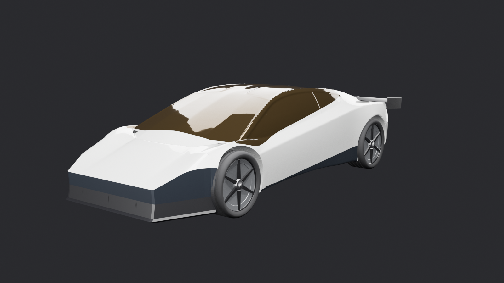

# Rocket Roadster

A fan-made 3D Roadster configurator and driving game that runs in the browser. Build your car, then drive the real Shafer Trail near Moab, Utah to Thelma & Louise Point, take off on the thrusters, do flips on the RCS jets, and fly all the way to orbit and back.

**Play it:** https://linaventures.github.io/rocket-roadster/

Unofficial fan build, not affiliated with Tesla or SpaceX.



## What's in it

- **Studio:** paint (including pinks), glass, accents, wheels, interior, diamonds (a ridge line or full pavé), butterfly doors, a cabin view, a launch demo, and a poster maker with shareable build codes.
- **Share your car:** the poster's Share on X button posts a link like `?car=RR-26131111-LINA`, which opens the game and drops you on the road in exactly that car.
- **The canyon drive:** about 7 km of the real Shafer Trail on real terrain and aerial imagery, ending at the rim above the Colorado River where the film's final scene was shot.
- **Flying:** take off, fly over the canyon, drive off the rim and catch yourself on the thrusters, or keep climbing to a 400 km orbit over a real Earth and re-enter through a plasma glow.
- **Night mode:** stars, moonlight and working headlights.
- **Sound:** an original western house soundtrack, plus Tesla-style car sound (motor whine that follows speed, gravel, wind, the low-speed pedestrian hum, thrusters).

## Controls

| Action | Keys |
| --- | --- |
| Accelerate / brake | W or ↑ / S or ↓ |
| Steer | A D or ← → |
| Boost | Shift |
| Jump, or climb while flying | Space |
| Descend | C |
| Take off / land | T |
| Barrel roll / front flip / backflip / spin | Q or E / R / B / X |
| Orbit and back | O |
| Night | N |
| Driver's seat / camera / music | F / V / M |
| Leave | Esc |

Phones get a thumb pad and buttons.

## How the physics works

It's arcade, not a simulator. The car has a top speed, steering that gets less twitchy as you go faster, and it tilts to follow the real ground under its wheels (a heightfield from elevation data). Rock walls stop you, and when the ground drops away faster than about 30° the car leaves it and flies on in a ballistic arc.

Tricks are flown on RCS jets. A burst of pulses spins the car up, it coasts on momentum with small corrective puffs, the opposite jets brake it, and it overshoots a little and settles, rotating about its centre of mass. Each jet fires only if its push turns the car the right way.

The trip to orbit draws space as a second scene in kilometres behind the car scene, so depth precision holds from the road up to 400 km.

## How it's built

- One page (`index.html`): three.js 0.147, Web Audio, no build step. It loads everything else from `assets/` as base64 text.
- The car started as a Hunyuan 3D generation, rebuilt as clean quads in Blender (`pipeline/car/retopo_roadster.py`, `finish_roadster.py`) and finished with glTF Transform (`reference-pass.mjs`). The source models aren't in this repo, because they were generated from reference photos we don't own.
- The canyon is built by `pipeline/canyon/prep_canyon.py` from elevation tiles, aerial imagery and the OpenStreetMap road next to it. The Earth is built by `pipeline/orbit/prep_orbit.py`.
- Music and sound effects were generated with ElevenLabs through fal (`pipeline/audio/el_music.py`, `el_sfx.py`) and packed by `pack_sfx.py`. A fully synthesised version of the music is in the page as a fallback (`music-module.js`).

## Layout

```
index.html        the game
assets/           what the game loads: car, canyon, orbit, audio, draco (the mesh decoder)
pipeline/         the scripts that made the assets, grouped the same way
docs/             images for this README
```

To run it locally, serve the folder over HTTP (it won't work from a file URL):

```sh
python3 -m http.server 8000
```

Then open http://localhost:8000.

## Credits

- Terrain: [AWS Terrain Tiles](https://registry.opendata.aws/terrain-tiles/) (USGS 3DEP and others)
- Aerial imagery: [USGS The National Map](https://www.usgs.gov/programs/national-geospatial-program/national-map) (public domain)
- Road: © [OpenStreetMap](https://www.openstreetmap.org/copyright) contributors, ODbL
- Earth: NASA Blue Marble, Black Marble and Visible Earth (public domain)
- Music and sound effects: generated with ElevenLabs Music and Sound Effects, through fal
- three.js, glTF Transform, Draco, Blender

The filming location for the Thelma & Louise ending is documented by the [Utah Film Commission](https://film.utah.gov/thelma-louise-30).

## Licence

The code (`index.html` and the scripts in `pipeline/`) is MIT licensed; see [LICENSE](LICENSE).

The data and media keep their own terms:

- the OpenStreetMap road data (in `pipeline/canyon/` and the road in `assets/canyon/canyon.json`) is under the ODbL, with the attribution above
- the elevation, USGS imagery and NASA Earth imagery follow their sources' terms (USGS and NASA material is public domain)
- the music and sound effects were generated with ElevenLabs through fal and follow those services' terms
- the car model is a fan-made approximation, and the names Tesla, Roadster and SpaceX belong to their owners
